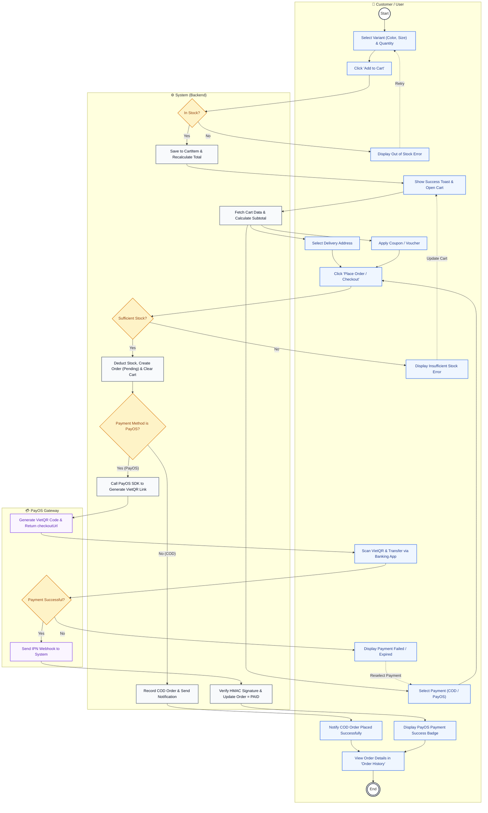

# 📖 BẢN HƯỚNG DẪN REVIEW CODE & THUYẾT MINH NGHIỆP VỤ BÁM SÁT SWIMLANE
> **Chủ sở hữu:** Đào Quang Huy (Huydqhe186273)  
> **Dự án:** Fashion Store (Thương mại điện tử thời trang tích hợp PayOS & COD)  
> **Phạm vi nhiệm vụ:** Iteration 1 & Iteration 2 (Epic II.5 Giỏ hàng & Đơn hàng, Epic II.8 Thanh toán PayOS, Epic II.9 Thông báo)  
> **File biểu đồ chuẩn:** [`make_order_diagram.drawio`](file:///e:/KI%20dai%20chien%20cuoi%20cung/FA-2026/game/make_order_diagram.drawio) | [`make_order_swimlane.mmd`](file:///e:/KI%20dai%20chien%20cuoi%20cung/FA-2026/game/make_order_swimlane.mmd)

---

## 📌 BẢNG TỔNG HỢP DANH MỤC TÍNH NĂNG CỦA HUY TRONG DỰ ÁN

| Mã Task | Epic | Tên Tính Năng (Feature) | Loại | Trạng Thái Sprint | File Code Chính (Luồng gọi ➔) |
| :--- | :--- | :--- | :--- | :--- | :--- |
| **II.5.1** | II.5 | **Cart Screen** (Xem giỏ hàng) | Screen | `Done` | `Cart.jsx` ➔ `cartService.js` ➔ `CartController.java` ➔ `CartService.java` ➔ `CartRepository.java` |
| **II.5.2** | II.5 | **Add to Cart** (Thêm vào giỏ hàng) | Function | `Done` | `ProductDetailPage.jsx` ➔ `cartService.js` ➔ `CartController.java` ➔ `CartService.java` ➔ `CartItemRepository.java` |
| **II.5.3** | II.5 | **Edit Cart** (Tăng/giảm SL, đổi size/màu) | Function | `Done` | `Cart.jsx` ➔ `cartService.js` ➔ `CartController.java` ➔ `CartService.java` ➔ `CartItemRepository.java` |
| **II.5.4** | II.5 | **Remove Cart Item** (Xóa món khỏi giỏ) | Function | `Done` | `Cart.jsx` ➔ `cartService.js` ➔ `CartController.java` ➔ `CartService.java` ➔ `CartItemRepository.java` |
| **II.5.5** | II.5 | **Apply Coupon** (Áp dụng voucher giảm giá) | Function | `Done` | `Cart.jsx` ➔ `couponService.js` ➔ `CouponController.java` ➔ `DiscountCodeService.java` ➔ `DiscountCodeRepository.java` |
| **II.5.6** | II.5 | **Checkout Screen** (Chọn địa chỉ, COD / PayOS) | Screen | `Done` | `Cart.jsx` ➔ `addressService.js` ➔ `AddressController.java` ➔ `AddressService.java` ➔ `AddressRepository.java` |
| **II.5.7** | II.5 | **Create Order** (Tạo đơn hàng & trừ tồn kho) | Function | `Done` | `Cart.jsx` ➔ `orderService.js` ➔ `OrderController.java` ➔ `OrderService.java` ➔ `OrderRepository.java` |
| **II.5.8** | II.5 | **Order History Screen** (Xem lịch sử & lọc tab) | Screen | `Done` | `OrderHistory.jsx` ➔ `orderService.js` ➔ `OrderController.java` ➔ `OrderService.java` ➔ `OrderRepository.java` |
| **II.5.9** | II.5 | **Order Details** (Xem chi tiết đơn hàng) | Function | `Done` | `OrderHistory.jsx` ➔ `orderService.js` ➔ `OrderController.java` ➔ `OrderService.java` ➔ `OrderDetailRepository.java` |
| **II.5.10**| II.5 | **Cancel Order** (Khách hàng hủy đơn pending) | Function | `Done` | `OrderHistory.jsx` ➔ `orderService.js` ➔ `OrderController.java` ➔ `OrderService.java` ➔ `ProductVariantRepository.java` |
| **II.5.11**| II.5 | **Return / Refund** (Yêu cầu trả hàng & hoàn tiền)| Function | `Done` | `OrderHistory.jsx` ➔ `orderService.js` ➔ `OrderController.java` ➔ `OrderService.java` ➔ `OrderRepository.java` |
| **II.8.1** | II.8 | **Create PayOS Link** (Tạo link quét VietQR) | API | `Done` | `Cart.jsx` ➔ `paymentService.js` ➔ `PaymentController.java` ➔ `PayOS SDK` |
| **II.8.2** | II.8 | **PayOS Webhook** (Nhận webhook bảo mật HMAC) | API | `Done` | `PayOS Server` ➔ `PaymentController.java` ➔ `OrderService.java` ➔ `PaymentRepository.java` |
| **II.8.3** | II.8 | **Payment Status** (Tra cứu & lưu bảng Payments) | API | `Done` | `OrderHistory.jsx` ➔ `PaymentController.java` ➔ `PaymentRepository.java` ➔ `OrderRepository.java` |
| **II.9.4** | II.9 | **Order Notification** (Gửi thông báo đơn hàng) | API | `Done` | `OrderService.java` ➔ `NotificationService.java` ➔ `NotificationRepository.java` |
| **II.9.5** | II.9 | **Notification List** (Trang danh sách thông báo) | Screen | `Done` | `CustomerNavbar.jsx` / `NotificationsPage.jsx` ➔ `notificationService.js` ➔ `NotificationController.java` ➔ `NotificationService.java` |
| **II.9.6** | II.9 | **Mark Read Notification** (Đánh dấu đã đọc) | Function | `Done` | `NotificationsPage.jsx` ➔ `notificationService.js` ➔ `NotificationController.java` ➔ `NotificationService.java` |

---

## 📊 SƠ ĐỒ SWIMLANE NGHIỆP VỤ (MAKE ORDER)

> 💡 **Cách xem sơ đồ:**  
> * **Cách 1 (Xem trực quan ngay lập tức):** Xem sơ đồ Mermaid được nhúng trực tiếp dưới đây.  
> * **Cách 2 (Mở bằng Draw.io):** Kéo thả file [`make_order_diagram.drawio`](file:///e:/KI%20dai%20chien%20cuoi%20cung/FA-2026/game/make_order_diagram.drawio) vào trình duyệt [app.diagrams.net](https://app.diagrams.net) (hoặc menu **Tập tin** ➔ **Mở từ** ➔ **Thiết bị...**).



---

# 🎯 HƯỚNG DẪN REVIEW CODE CHI TIẾT TỪNG BƯỚC THEO SWIMLANE

---

### GIAI ĐOẠN 1: CHỌN SẢN PHẨM & THÊM VÀO GIỎ HÀNG
*(Luồng đi: Người dùng ➔ Hệ thống ➔ Người dùng)*

#### 1. [Node 0 & 1] Chọn biến thể (Màu, Size, Số lượng)
* **Vị trí code:** [`frontend/src/pages/customer/ProductDetailPage.jsx`](file:///e:/KI%20dai%20chien%20cuoi%20cung/FA-2026/game/frontend/src/pages/customer/ProductDetailPage.jsx#L25-L27)
  * Dòng `25 - 27`: Khai báo các State: `selectedColor`, `selectedSize`, `quantity`.
  * Dòng `225 - 265`: Giao diện hiển thị các nút chọn màu, kích cỡ và điều chỉnh số lượng.
* **Lời thoại thuyết minh:**
  > *"Tại màn hình chi tiết sản phẩm `ProductDetailPage.jsx`, người dùng chọn màu sắc và kích cỡ. Hệ thống sẽ dựa vào cặp (Color, Size) để khớp với `ProductVariant` tương ứng và hiển thị số lượng tồn kho còn lại."*

#### 2. [Node 2] Click "Thêm vào giỏ hàng"
* **Vị trí code:** [`ProductDetailPage.jsx:113-148`](file:///e:/KI%20dai%20chien%20cuoi%20cung/FA-2026/game/frontend/src/pages/customer/ProductDetailPage.jsx#L113-L148) ➔ [`frontend/src/services/cartService.js:40-43`](file:///e:/KI%20dai%20chien%20cuoi%20cung/FA-2026/game/frontend/src/services/cartService.js#L40-L43)
  * `ProductDetailPage.jsx` (Dòng 113): Hàm `handleAddToCart()` kiểm tra điều kiện đã chọn đủ màu/size, sau đó gọi `addToCart(userId, variantId, quantity)`.
  * `cartService.js` (Dòng 40): Gửi `POST /api/cart/add` kèm Request Body JSON `{ variantId, quantity }`.
* **Lời thoại thuyết minh:**
  > *"Khi bấm nút 'Thêm vào giỏ', hàm `handleAddToCart()` gửi yêu cầu `POST /api/cart/add` tới Backend qua Axios."*

#### 3. [Node 3] Quyết định: Còn hàng? (Hệ thống kiểm tra tồn kho)
* **Vị trí code:** [`CartController.java:24-28`](file:///e:/KI%20dai%20chien%20cuoi%20cung/FA-2026/game/backend/src/main/java/com/example/myapp/controller/CartController.java#L24-L28) ➔ [`CartService.java:45-48`](file:///e:/KI%20dai%20chien%20cuoi%20cung/FA-2026/game/backend/src/main/java/com/example/myapp/service/CartService.java#L45-L48)
  * Code kiểm tra tồn kho:
    ```java
    if (variant.getStockQuantity() < request.getQuantity()) {
        throw new RuntimeException("Số lượng yêu cầu vượt quá tồn kho hiện có");
    }
    ```
* **Rẽ nhánh nghiệp vụ:**
  * **[Node 5 - Nhánh No]:** Nếu kho không đủ ➔ Ném ngoại lệ `RuntimeException`, Frontend nhận HTTP 400 và gọi `toast.error()` báo cho người dùng, giữ nguyên giao diện để người dùng chọn lại ở Node 1.
  * **[Node 4 - Nhánh Yes]:** Nếu kho còn đủ ➔ Tiếp tục chuyển sang bước lưu giỏ hàng.

#### 4. [Node 4] Lưu món vào CartItem & Tính lại giỏ
* **Vị trí code:** [`CartService.java:50-71`](file:///e:/KI%20dai%20chien%20cuoi%20cung/FA-2026/game/backend/src/main/java/com/example/myapp/service/CartService.java#L50-L71)
  * Dòng `50 - 60`: Kiểm tra nếu biến thể đã có trong giỏ thì cộng dồn số lượng; nếu chưa có thì khởi tạo mới và gọi `cartItemRepository.save(item)`.
  * Dòng `62 - 71`: Gọi hàm nội bộ `recalculateCartTotals(cart)` để tính lại tổng tiền giỏ hàng.
  * **Bảng CSDL ảnh hưởng:** Bảng `CartItems` (INSERT hoặc UPDATE) và `Carts` (UPDATE `total_price`).
* **Lời thoại thuyết minh:**
  > *"Backend lưu bản ghi vào bảng `CartItems`, tự động cộng dồn số lượng nếu sản phẩm đã có sẵn trong giỏ, sau đó tính toán lại tổng tiền giỏ hàng và trả về `CartDTO`."*

#### 5. [Node 6 & 7] Thông báo thành công, Mở giỏ & Tính tạm tính
* **Vị trí code:** [`ProductDetailPage.jsx:142`](file:///e:/KI%20dai%20chien%20cuoi%20cung/FA-2026/game/frontend/src/pages/customer/ProductDetailPage.jsx#L142) ➔ [`frontend/src/pages/Cart.jsx:66-109`](file:///e:/KI%20dai%20chien%20cuoi%20cung/FA-2026/game/frontend/src/pages/Cart.jsx#L66-L109)
  * `ProductDetailPage.jsx` (Dòng 142): `toast.success("Thêm vào giỏ hàng thành công!")`.
  * `Cart.jsx` (Dòng 66 - 80): Hàm `loadCart()` gọi API `GET /api/cart?userId=...` ([`CartController.java:18`](file:///e:/KI%20dai%20chien%20cuoi%20cung/FA-2026/game/backend/src/main/java/com/example/myapp/controller/CartController.java#L18)) lấy danh sách các món trong giỏ và hiển thị phần tiền tạm tính (`subtotal`).

---

### GIAI ĐOẠN 2: CHUẨN BỊ ĐẶT HÀNG (FORK / JOIN SONG SONG)
*(Luồng đi: Người dùng tương tác song song trên cùng màn hình Checkout)*

#### 6. [Node 8 - Fork Bar] 3 Thao tác Checkout song song
* **[Node 8a] Chọn địa chỉ nhận hàng:**
  * File: [`Cart.jsx:520-565`](file:///e:/KI%20dai%20chien%20cuoi%20cung/FA-2026/game/frontend/src/pages/Cart.jsx#L520-L565) ➔ Gọi `addressService.getUserAddresses()` nạp danh sách địa chỉ, lưu vào State `selectedAddressId`.
* **[Node 8b] Nhập mã giảm giá Voucher:**
  * File: [`Cart.jsx:256-290`](file:///e:/KI%20dai%20chien%20cuoi%20cung/FA-2026/game/frontend/src/pages/Cart.jsx#L256-L290) ➔ Hàm `handleApplyCoupon()` gọi `couponService.applyCoupon()` sang [`CouponController.java:20`](file:///e:/KI%20dai%20chien%20cuoi%20cung/FA-2026/game/backend/src/main/java/com/example/myapp/controller/CouponController.java#L20) kiểm tra hạn dùng, số lượt và tính số tiền giảm trừ (`discountAmount`).
* **[Node 8c] Chọn phương thức thanh toán:**
  * File: [`Cart.jsx:760-815`](file:///e:/KI%20dai%20chien%20cuoi%20cung/FA-2026/game/frontend/src/pages/Cart.jsx#L760-L815) ➔ State `paymentMethod`: Radio options chọn `'COD'` (Thanh toán khi nhận hàng) hoặc `'PAYOS'` (Chuyển khoản VietQR).
* **Lời thoại thuyết minh:**
  > *"Tại giao diện Checkout trong `Cart.jsx`, tôi thiết kế theo cơ chế song song (Fork): người dùng có thể tùy ý chọn địa chỉ giao hàng, nhập mã voucher giảm giá và chọn phương thức thanh toán COD hoặc PayOS trước khi bấm Đặt hàng."*

#### 7. [Node 9 & 10 - Join Bar] Bấm "Đặt hàng / Thanh toán"
* **Vị trí code:** [`Cart.jsx:369-485`](file:///e:/KI%20dai%20chien%20cuoi%20cung/FA-2026/game/frontend/src/pages/Cart.jsx#L369-L485)
  * Dòng `369`: Hàm `handleCheckout()` tổng hợp toàn bộ các dữ kiện: `{ userId, addressId, couponCode, paymentMethod }`.
  * Dòng `453`: Gọi `orderService.createOrderFromCart(...)` gửi request `POST /api/orders/create-from-cart`.

---

### GIAI ĐOẠN 3: XỬ LÝ TẠO ĐƠN, CHECK TỒN KHO & TRỪ KHO (BACKEND)
*(Luồng đi: Hệ thống kiểm tra giao dịch an toàn và toàn vẹn dữ liệu)*

#### 8. [Node 11] Quyết định: Kho đủ hàng?
* **Vị trí code:** [`OrderController.java:19-30`](file:///e:/KI%20dai%20chien%20cuoi%20cung/FA-2026/game/backend/src/main/java/com/example/myapp/controller/OrderController.java#L19-L30) ➔ [`OrderService.java:60-75`](file:///e:/KI%20dai%20chien%20cuoi%20cung/FA-2026/game/backend/src/main/java/com/example/myapp/service/OrderService.java#L60-L75)
  * Code duyệt kiểm tra:
    ```java
    for (CartItem item : cart.getItems()) {
        ProductVariant variant = item.getVariant();
        int availableStock = variant.getStockQuantity() != null ? variant.getStockQuantity() : 0;
        if (availableStock < item.getQuantity()) {
            throw new RuntimeException("Sản phẩm " + variant.getProduct().getName() + " không đủ số lượng trong kho!");
        }
    }
    ```
* **Rẽ nhánh nghiệp vụ:**
  * **[Node 12 - Nhánh No]:** Báo lỗi vượt quá tồn kho ➔ Trả HTTP 400, Client hiển thị thông báo lỗi và điều hướng quay lại trang giỏ hàng để cập nhật số lượng.
  * **[Node 13 - Nhánh Yes]:** Kho đủ toàn bộ các món ➔ Bắt đầu tạo đơn và trừ kho.

#### 9. [Node 13] Trừ tồn kho biến thể, Tạo Order (Pending) & Xóa giỏ hàng
* **Vị trí code:** [`OrderService.java:78-115`](file:///e:/KI%20dai%20chien%20cuoi%20cung/FA-2026/game/backend/src/main/java/com/example/myapp/service/OrderService.java#L78-L115)
  * Dòng `80 - 88`: Trừ tồn kho trong DB:
    ```java
    variant.setStockQuantity(availableStock - item.getQuantity());
    productVariantRepository.save(variant);
    ```
  * Dòng `90 - 105`: Khởi tạo đối tượng `Order` với trạng thái ban đầu `OrderStatus.PENDING`, lưu chi tiết từng món vào bảng `OrderDetails`.
  * Dòng `110`: Xóa các món trong giỏ: `cartItemRepository.deleteAll(cart.getItems())`.
  * **Các bảng CSDL liên quan:** `ProductVariants` (UPDATE kho), `Orders` (INSERT đơn hàng), `OrderDetails` (INSERT chi tiết đơn), `CartItems` (DELETE các món).
* **Lời thoại thuyết minh:**
  > *"Hàm `createOrderFromCart` được bọc bởi `@Transactional`. Hệ thống thực hiện trừ tồn kho của từng biến thể sản phẩm, lưu đơn hàng trạng thái PENDING, ghi các dòng chi tiết đơn và làm rỗng giỏ hàng một cách an toàn."*

---

### GIAI ĐOẠN 4: RẼ NHÁNH THANH TOÁN (COD vs PAYOS)

#### 10. [Node 14] Quyết định: Phương thức PayOS?
* **Vị trí code:** [`OrderService.java:125-135`](file:///e:/KI%20dai%20chien%20cuoi%20cung/FA-2026/game/backend/src/main/java/com/example/myapp/service/OrderService.java#L125-L135) & [`Cart.jsx:460-475`](file:///e:/KI%20dai%20chien%20cuoi%20cung/FA-2026/game/frontend/src/pages/Cart.jsx#L460-L475)

---

#### 🔵 NHÁNH COD: THANH TOÁN KHI NHẬN HÀNG
* **[Node 18] Ghi nhận COD & Bắn thông báo chuông:**
  * File [`OrderService.java:128-134`](file:///e:/KI%20dai%20chien%20cuoi%20cung/FA-2026/game/backend/src/main/java/com/example/myapp/service/OrderService.java#L128-L134): Gọi `notificationService.createNotification(userId, "order", "Đơn hàng #" + order.getOrderId() + " đã được đặt thành công với hình thức COD...")`.
* **[Node 22] Thông báo đặt hàng COD thành công:**
  * File [`Cart.jsx:472`](file:///e:/KI%20dai%20chien%20cuoi%20cung/FA-2026/game/frontend/src/pages/Cart.jsx#L472): Hiển thị Toast thành công và điều hướng `navigate('/orders')` sang màn hình Lịch sử đơn hàng.

---

#### 🟣 NHÁNH PAYOS: THANH TOÁN ONLINE QUA CỔNG VIETQR
* **[Node 15] Backend gọi PayOS SDK tạo link thanh toán:**
  * File [`PaymentController.java:32-65`](file:///e:/KI%20dai%20chien%20cuoi%20cung/FA-2026/game/backend/src/main/java/com/example/myapp/controller/PaymentController.java#L32-L65):
    ```java
    CreatePaymentLinkRequest request = CreatePaymentLinkRequest.builder()
        .orderCode(order.getOrderId().longValue())
        .amount(order.getTotalAmount().longValue())
        .description("DH" + order.getOrderId())
        .returnUrl(clientHost + "/orders?payment=success")
        .cancelUrl(clientHost + "/orders?payment=cancel")
        .build();
    CreatePaymentLinkResponse response = payOS.paymentRequests().create(request);
    ```
* **[Node 16] Cổng PayOS trả về checkoutUrl & Mã VietQR:**
  * PayOS Server sinh mã QR VietQR động chứa số tiền và nội dung chuyển khoản tự động.
* **[Node 17] Người dùng quét mã VietQR và chuyển tiền:**
  * Khách hàng quét mã trên App ngân hàng để hoàn tất thanh toán.
* **[Node 19 & 20] PayOS kiểm tra biến động số dư & Gửi Webhook IPN:**
  * Khi tiền vào tài khoản thụ hưởng thành công, PayOS Server gửi HTTP POST Webhook tới endpoint: `/api/payment/payos_transfer_handler`.
* **[Node 21 - Nếu thanh toán thất bại / Hết hạn]:** PayOS trả về lỗi hoặc redirect cancelUrl ➔ Báo lỗi cho người dùng và cho chọn lại PTTT ở Node 8c.
* **[Node 23] Backend xác thực chữ ký HMAC SHA-256 & Đổi Order = PAID:**
  * File [`PaymentController.java:95-135`](file:///e:/KI%20dai%20chien%20cuoi%20cung/FA-2026/game/backend/src/main/java/com/example/myapp/controller/PaymentController.java#L95-L135):
    ```java
    WebhookData data = payOS.verifyPaymentWebhookData(webhookBody);
    Order order = orderService.getOrderById((int) data.getOrderCode());
    order.setOrderStatus(OrderStatus.PAID);
    // Lưu bảng Payments & gửi Notification thanh toán thành công
    ```
* **[Node 24] Hiển thị thanh toán PayOS thành công:**
  * Giao diện cập nhật huy hiệu `Đã thanh toán` màu xanh lục.

---

### GIAI ĐOẠN 5: XEM LỊCH SỬ ĐƠN & KẾT THÚC
*(Luồng đi: Hội tụ về trang Lịch sử đơn hàng)*

#### 11. [Node 25 & Node End] Xem đơn hàng tại Lịch sử đơn hàng
* **Vị trí code:** [`frontend/src/pages/customer/OrderHistory.jsx:45-220`](file:///e:/KI%20dai%20chien%20cuoi%20cung/FA-2026/game/frontend/src/pages/customer/OrderHistory.jsx#L45-L220)
  * Hàm `loadOrders()` gọi API `GET /api/orders/user/{userId}` lấy danh sách đơn hàng đã đặt.
  * Hiển thị đầy đủ thông tin: Mã đơn, Thời gian đặt, Danh sách món hàng, Tổng tiền, Phương thức thanh toán (COD / PayOS) và Trạng thái (`Chờ xử lý` hoặc `Đã thanh toán`).
* **Lời thoại kết luận:**
  > *"Dù đi theo luồng COD hay PayOS, luồng nghiệp vụ đều hội tụ về màn hình Lịch sử đơn hàng `OrderHistory.jsx`. Tại đây người dùng có thể theo dõi tiến độ, xem chi tiết, hoặc thao tác hủy / yêu cầu trả hàng & hoàn tiền khi cần thiết."*

---

## 💡 BỘ CÂU HỎI PHẢN BIỆN THƯỜNG GẶP CỦA GIẢNG VIÊN & CÁCH TRẢ LỜI ĂN ĐIỂM

### Câu 1: "Tại sao phương thức `createOrderFromCart` phải có annotation `@Transactional`?"
* **Trả lời:**
  > *"Dạ thưa thầy/cô, việc tạo đơn hàng bao gồm nhiều bước ghi dữ liệu phụ thuộc nhau: trừ tồn kho trong `ProductVariants`, tạo bản ghi trong `Orders`, tạo các dòng trong `OrderDetails`, và xóa các món trong `CartItems`. Nếu không có `@Transactional`, giả sử bước trừ kho thành công nhưng bước lưu chi tiết đơn bị lỗi thì hệ thống sẽ bị mất tồn kho mà không có đơn hàng. `@Transactional` đảm bảo tính nguyên tử (Atomicity) theo chuẩn ACID — nếu có bất kỳ lỗi nào xảy ra, toàn bộ thao tác sẽ được rollback tự động về trạng thái ban đầu."*

### Câu 2: "Tại sao Webhook của PayOS lại cần xác thực bằng chữ ký HMAC SHA-256?"
* **Trả lời:**
  > *"Dạ thưa thầy/cô, Webhook là một public API endpoint mà bất kỳ ai trên internet cũng có thể gửi request tới. Nếu không kiểm tra chữ ký số, một hacker có thể tự tạo một payload giả mạo gửi tới endpoint này để kích hoạt đổi đơn hàng sang trạng thái 'Đã thanh toán'. Hàm `payOS.verifyPaymentWebhookData()` sử dụng `CHECKSUM_KEY` bí mật để tính toán và đối soát mã hash SHA-256 kèm theo payload. Chỉ những request thực sự xuất phát từ máy chủ PayOS mới vượt qua bước xác thực này."*

### Câu 3: "Nếu khách hàng quét mã PayOS thành công nhưng vô tình tắt trình duyệt thì đơn hàng có cập nhật thành Đã thanh toán không?"
* **Trả lời:**
  > *"Dạ vẫn cập nhật bình thường ạ. Hệ thống của em triển khai cơ chế 2 kênh độc lập:
  > - **Kênh 1 (Redirect):** Dùng để nâng cao trải nghiệm người dùng, chuyển hướng trình duyệt về web khi vừa quét xong.
  > - **Kênh 2 (Webhook Server-to-Server):** Hoạt động ngầm từ máy chủ PayOS bắn thẳng về máy chủ Backend của em. Dù khách hàng tắt mạng hay tắt trình duyệt, Webhook vẫn gọi về Backend, xác thực chữ ký và cập nhật `OrderStatus = PAID` ngay lập tức."*

### Câu 4: "Khi thêm sản phẩm vào giỏ hàng, tại sao em không trừ luôn tồn kho trong cơ sở dữ liệu?"
* **Trả lời:**
  > *"Dạ thưa thầy/cô, giỏ hàng chỉ mang tính chất dự định mua. Nếu trừ kho ngay khi thêm vào giỏ, một người dùng có thể thêm toàn bộ kho hàng vào giỏ rồi không thanh toán, dẫn đến việc những khách hàng khác không thể mua được (tình trạng giữ chỗ ảo). Do đó, nghiệp vụ chuẩn của TMĐT là chỉ trừ tồn kho thực tế tại thời điểm khách hàng chính thức bấm 'Đặt hàng' (Checkout)."*
