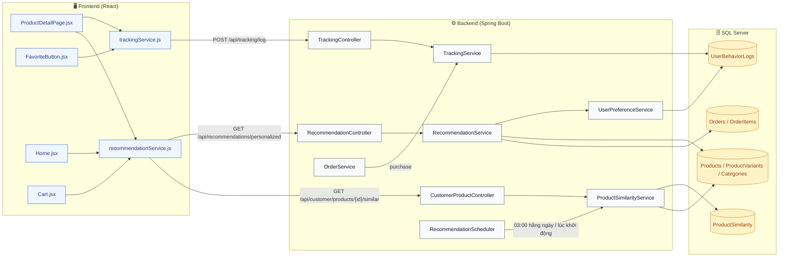
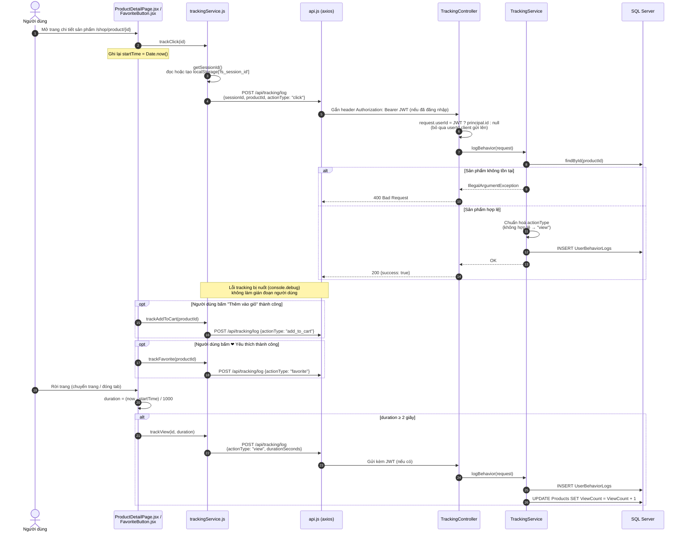
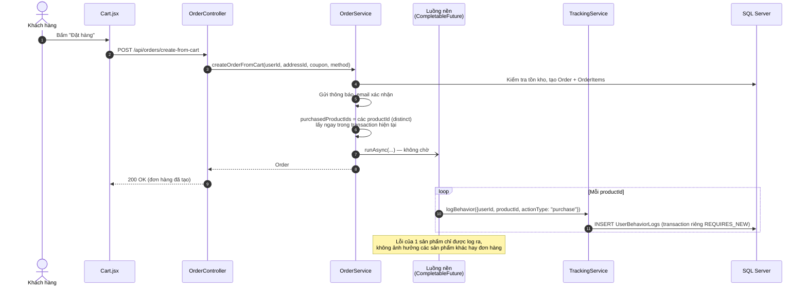
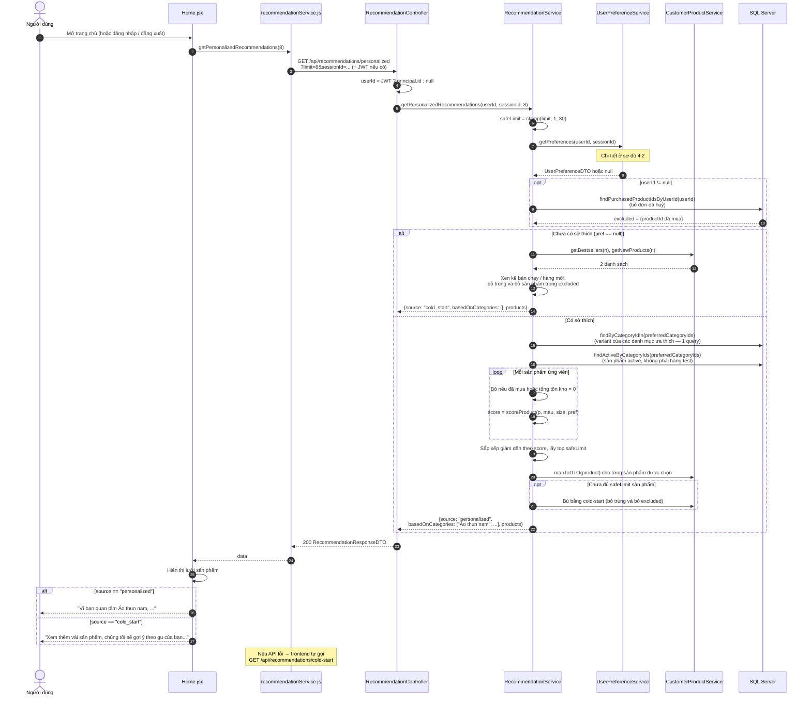
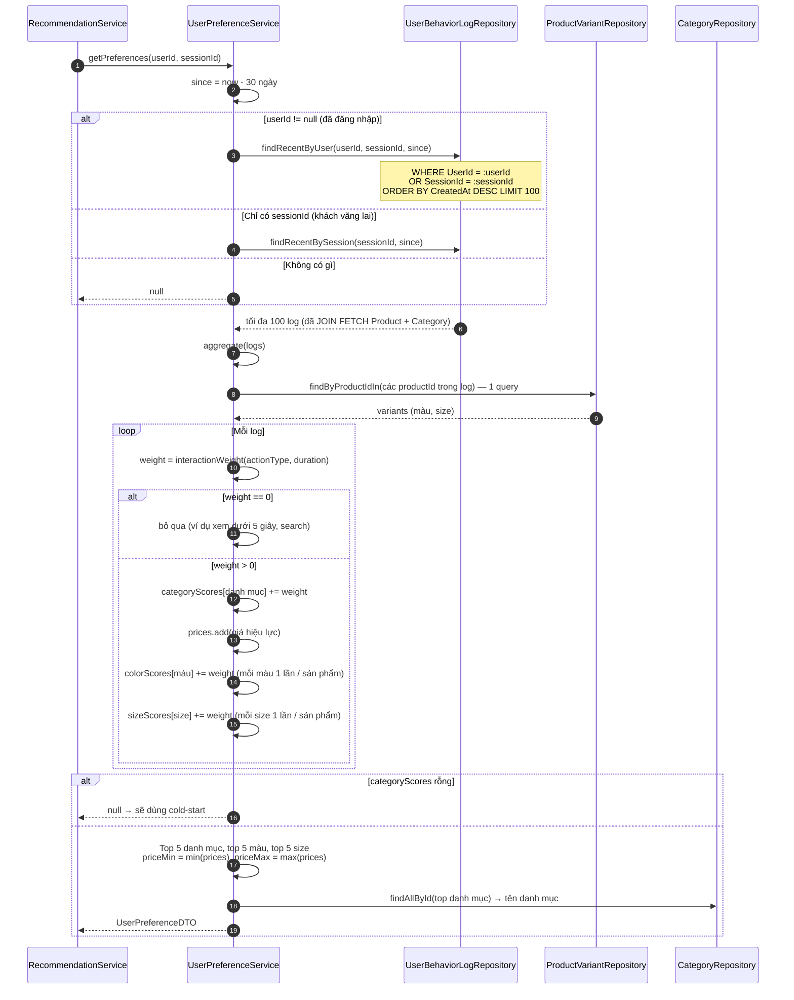
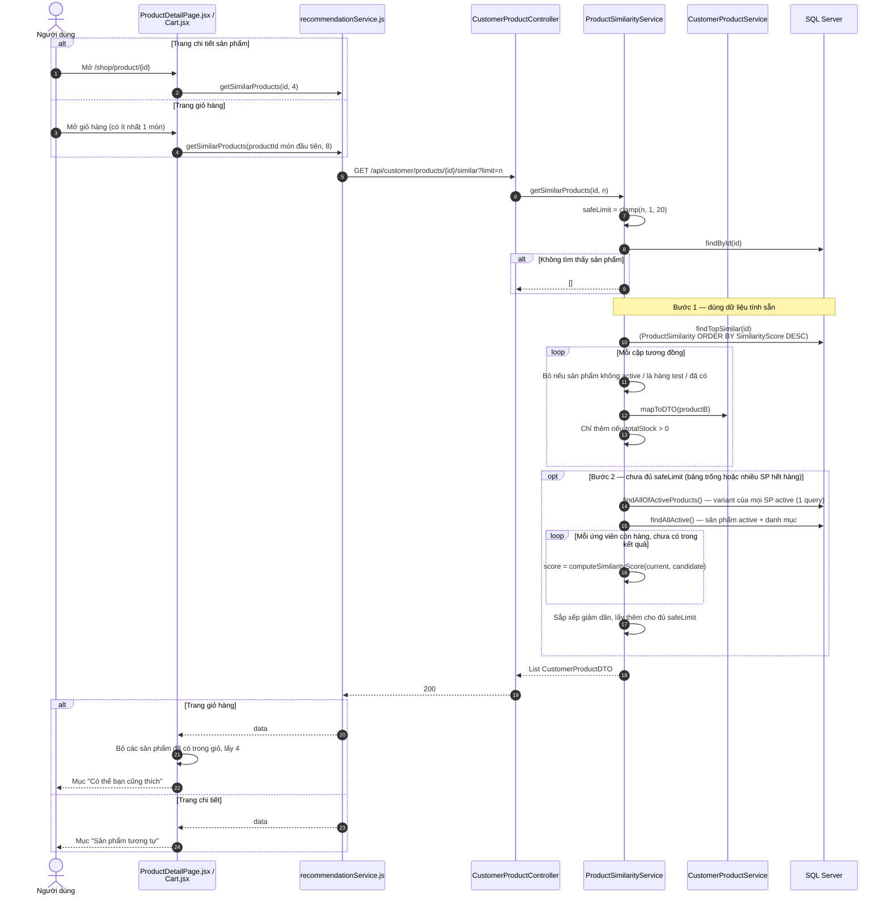
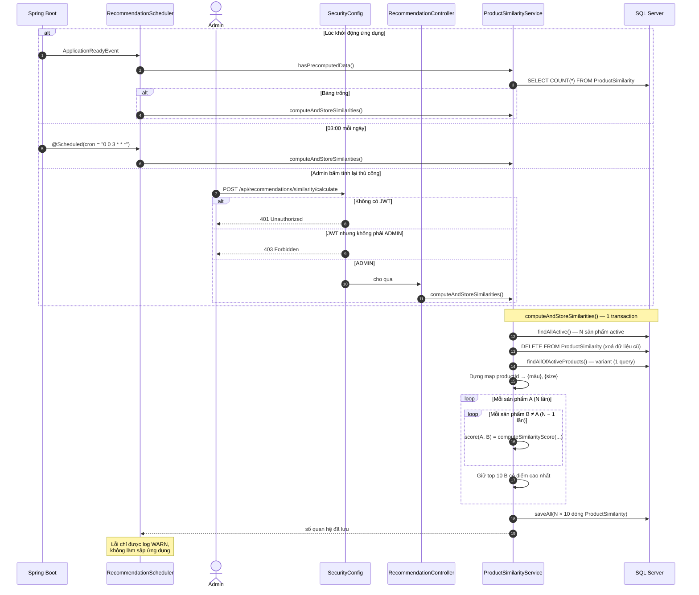
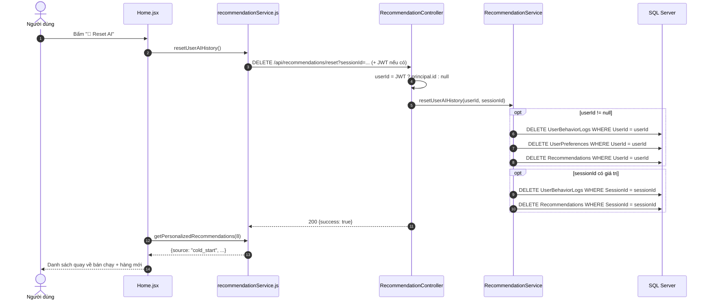

# 📖 THUYẾT MINH LUỒNG CHẠY MODULE GỢI Ý SẢN PHẨM (RECOMMENDATION)
> **Dự án:** Fashion Store (thương mại điện tử thời trang)
> **Phạm vi:** Toàn bộ module gợi ý: thu thập hành vi → hồ sơ sở thích → gợi ý "Dành cho bạn" → "Sản phẩm tương tự" → tính sẵn độ tương đồng → reset dữ liệu.
> **Loại thuật toán:** Rule-based (chấm điểm theo luật), không dùng Machine Learning.
> **Sơ đồ swimlane (draw.io):** [`ai_recommendation_swimlane.drawio`](ai_recommendation_swimlane.drawio). Mở bằng [app.diagrams.net](https://app.diagrams.net) → **File** → **Open from** → **Device…** (2 trang: *Gợi ý Dành cho bạn* và *Sản phẩm tương tự*).

---

## 1. TỔNG QUAN

### 1.1. Module làm được gì?

| # | Tính năng | Hiển thị ở đâu | Dựa trên |
| :--- | :--- | :--- | :--- |
| 1 | **Gợi ý "Dành cho bạn"** | Trang chủ (`Home.jsx`) | Hành vi gần đây của người dùng (xem, click, thêm giỏ, yêu thích, mua) |
| 2 | **Sản phẩm tương tự** | Trang chi tiết sản phẩm, trang giỏ hàng | Thuộc tính sản phẩm (danh mục, giới tính, giá, màu, size) |
| 3 | **Cold-start** | Phương án dự phòng cho (1) | Sản phẩm bán chạy + hàng mới (xen kẽ) |

### 1.2. Kiến trúc tổng thể



### 1.3. Danh sách file và vai trò

| Tầng | File | Vai trò |
| :--- | :--- | :--- |
| Frontend | `frontend/src/services/trackingService.js` | Tạo `sessionId` (lưu `localStorage['fs_session_id']`), gửi hành vi lên backend |
| Frontend | `frontend/src/services/recommendationService.js` | Gọi API gợi ý, sản phẩm tương tự, reset |
| Frontend | `frontend/src/pages/customer/ProductDetailPage.jsx` | Ghi `click`, `view` (kèm thời gian xem), `add_to_cart`; hiển thị "Sản phẩm tương tự" |
| Frontend | `frontend/src/components/customer/FavoriteButton.jsx` | Ghi `favorite` |
| Frontend | `frontend/src/pages/Home.jsx` | Hiển thị "Dành cho bạn" + lý do gợi ý + nút Reset AI |
| Frontend | `frontend/src/pages/Cart.jsx` | Hiển thị "Có thể bạn cũng thích" |
| Controller | `controller/TrackingController.java` | `POST /api/tracking/log`, gán `userId` từ JWT |
| Controller | `controller/RecommendationController.java` | `/api/recommendations/*` (personalized, cold-start, preferences, reset, similarity/calculate) |
| Controller | `controller/CustomerProductController.java` | `GET /api/customer/products/{id}/similar` |
| Service | `service/TrackingService.java` | Lưu `UserBehaviorLog`, tăng `ViewCount` khi `view` |
| Service | `service/UserPreferenceService.java` | Tổng hợp hành vi → hồ sơ sở thích (danh mục, giá, màu, size) |
| Service | `service/RecommendationService.java` | Chấm điểm và chọn sản phẩm "Dành cho bạn", cold-start, reset |
| Service | `service/ProductSimilarityService.java` | Tính / tra cứu độ tương đồng giữa 2 sản phẩm |
| Service | `service/OrderService.java` | Ghi hành vi `purchase` sau khi tạo đơn |
| Config | `config/RecommendationScheduler.java` | Tính lại `ProductSimilarity` lúc khởi động (nếu trống) và 03:00 mỗi ngày |
| Config | `config/SecurityConfig.java` | Chỉ ADMIN được gọi `POST /api/recommendations/similarity/**` |
| Model | `model/RecommendationResponseDTO.java` | `{ source, basedOnCategories, products }` |
| Model | `model/UserPreferenceDTO.java` | Hồ sơ sở thích |

### 1.4. Bảng dữ liệu sử dụng

| Bảng | Đọc / Ghi | Ý nghĩa |
| :--- | :--- | :--- |
| `UserBehaviorLogs` | Ghi (tracking), đọc (tính sở thích) | Mỗi dòng = 1 hành vi: `UserId` (null nếu khách), `SessionId`, `ProductId`, `ActionType`, `DurationSeconds`, `CreatedAt` |
| `ProductSimilarity` | Ghi (scheduler), đọc (sản phẩm tương tự) | Top 10 sản phẩm giống nhất cho mỗi sản phẩm: `ProductIdA`, `ProductIdB`, `SimilarityScore` |
| `Products`, `ProductVariants`, `Categories` | Đọc | Thông tin để chấm điểm (giá, danh mục, màu, size, tồn kho) |
| `Orders`, `OrderItems` | Đọc | Loại các sản phẩm user đã mua khỏi gợi ý |
| `UserPreferences`, `Recommendations` | Chỉ xoá khi reset | Bảng cũ, module **không còn ghi** vào (hồ sơ sở thích được tính trực tiếp mỗi lần) |

---

## 2. LUỒNG 1: THU THẬP HÀNH VI NGƯỜI DÙNG (TRACKING)

### 2.1. Sequence diagram



### 2.2. Giải thích chi tiết

1. **Định danh người dùng.**
   - Mọi trình duyệt đều có một `sessionId` ngẫu nhiên (ví dụ `sess_k3j2..._lx9a`), được tạo một lần và lưu trong `localStorage`.
   - Nếu người dùng đã đăng nhập, `api.js` tự gắn JWT vào header. `TrackingController` lấy `userId` từ JWT (`@AuthenticationPrincipal CustomUserDetails`), **không tin `userId` do client gửi**, nên không ai ghi hành vi giả mạo cho tài khoản khác được.
   - Khách vãng lai có `userId = null` và chỉ được nhận diện qua `sessionId`.
2. **Các hành vi được ghi:**

   | ActionType | Ghi ở đâu | Khi nào |
   | :--- | :--- | :--- |
   | `click` | `ProductDetailPage.jsx` | Ngay khi mở trang chi tiết |
   | `view` | `ProductDetailPage.jsx` | Khi rời trang, nếu đã ở lại ≥ 2 giây, kèm `durationSeconds` |
   | `add_to_cart` | `ProductDetailPage.jsx` | Sau khi thêm vào giỏ thành công |
   | `favorite` | `FavoriteButton.jsx` | Sau khi bấm yêu thích thành công |
   | `purchase` | `OrderService.java` (backend) | Sau khi tạo đơn hàng (xem Luồng 2) |

3. **Kiểm tra dữ liệu.** `actionType` phải nằm trong `view, search, click, add_to_cart, favorite, purchase` (khớp ràng buộc CHECK trong DB). Giá trị lạ được đổi thành `view`.
4. **Không chặn trải nghiệm.** Tracking là "fire-and-forget": nếu lỗi, frontend chỉ ghi `console.debug`, người dùng không thấy gì.
5. **Không tính toán gì thêm lúc ghi log.** Hồ sơ sở thích được tính **khi cần gợi ý** (Luồng 3), nên API tracking rất nhẹ.

---

## 3. LUỒNG 2: GHI HÀNH VI MUA HÀNG (PURCHASE)

### 3.1. Sequence diagram



### 3.2. Giải thích chi tiết

- `purchase` được ghi **ở backend** chứ không phải frontend. Cách này chắc chắn hơn, vì đơn hàng chỉ được ghi nhận khi thực sự tạo thành công.
- Ghi bất đồng bộ (`CompletableFuture.runAsync`) nên **không làm chậm** API đặt hàng.
- Danh sách `productId` được lấy **trước** khi chuyển sang luồng nền. Luồng nền không có Hibernate session, nên nếu truy cập entity lazy ở đó sẽ bị lỗi `LazyInitializationException`.
- `TrackingService.logBehavior` chạy với `Propagation.REQUIRES_NEW`, mỗi log là một transaction độc lập.

---

## 4. LUỒNG 3: GỢI Ý "DÀNH CHO BẠN" (TRANG CHỦ)

Đây là luồng chính của module.

### 4.1. Sequence diagram (tổng thể)



### 4.2. Sequence diagram (tính hồ sơ sở thích, bên trong `UserPreferenceService`)



### 4.3. Công thức 1: Trọng số hành vi (`UserPreferenceService.interactionWeight`)

| Hành vi | Điều kiện | Điểm | Ý nghĩa |
| :--- | :--- | :---: | :--- |
| `click` | — | 2 | Tò mò ban đầu |
| `view` | < 5 giây | 0 | Lướt nhầm / thoát nhanh → bỏ qua |
| `view` | 5 – 15 giây | 2 | Lướt thông tin |
| `view` | 15 – 40 giây | 5 | Đọc kỹ mô tả |
| `view` | > 40 giây | 8 | Rất quan tâm |
| `view` | không rõ thời gian | 1 | |
| `add_to_cart` | — | 6 | Có ý định mua |
| `favorite` | — | 10 | Thích chủ động |
| `purchase` | — | 12 | Tín hiệu mạnh nhất |
| `search` / khác | — | 0 | Không tính |

### 4.4. Công thức 2: Điểm phù hợp của sản phẩm (`RecommendationService.scoreProduct`)

| Tiêu chí | Điều kiện | Điểm |
| :--- | :--- | :---: |
| Danh mục | Danh mục ưa thích hạng 1 / 2 / 3 / 4 / 5 | 50 / 40 / 30 / 20 / 10 |
| Giá | Nằm trong `[priceMin, priceMax]` | 25 |
| Giá | Nằm trong `[priceMin × 0.75, priceMax × 1.25]` | 15 |
| Màu | Sản phẩm có ít nhất 1 màu ưa thích | 15 |
| Size | Sản phẩm có ít nhất 1 size ưa thích | 10 |
| Độ phổ biến | `min(10, SoldCount × 0.1)` + `min(5, ViewCount × 0.02)` | tối đa 15 |
| **Tổng tối đa** | | **115** |

**Bộ lọc trước khi chấm điểm:**
- Chỉ sản phẩm `Status = active`, `IsTest = false`, thuộc **top 5 danh mục ưa thích**.
- Tổng tồn kho các variant > 0.
- Chưa từng mua (đơn không bị huỷ). Chỉ áp dụng cho user đã đăng nhập.

### 4.5. Ví dụ tính toán (lấy từ lần chạy thử thật)

Khách vãng lai thực hiện 3 hành vi:

| Hành vi | Sản phẩm | Danh mục | Giá | Điểm |
| :--- | :--- | :--- | ---: | :---: |
| `favorite` | #2 | Áo thun nam | 399.000 | 10 |
| `view` 25 giây | #3 | Áo thun nam | 379.000 | 5 |
| `click` | #1 | Áo thun nam | 249.000 | 2 |

**Hồ sơ sở thích thu được:**
- Danh mục: `[Áo thun nam]` (17 điểm)
- Khoảng giá: 249.000 – 399.000
- Màu: Đen, Be, Xanh Navy, …
- Size: S, XL, L, …

**Chấm điểm một áo thun nam giá 300.000, có màu Đen, size M:**
`50 (danh mục hạng 1) + 25 (giá trong khoảng) + 15 (màu) + 10 (size) + độ phổ biến` ≈ **100+ điểm**, xếp đầu danh sách.

Danh mục "Áo thun nam" chỉ có 3 sản phẩm, nên 3 vị trí còn lại được **bù bằng cold-start**. Kết quả trả về:
```json
{
  "source": "personalized",
  "basedOnCategories": ["Áo thun nam"],
  "products": [ "#1, #2, #3 (Áo thun nam)", "#6, #133, #36 (bù từ cold-start)" ]
}
```

### 4.6. Các tình huống đặc biệt

| Tình huống | Hành vi của hệ thống |
| :--- | :--- |
| Khách mới, chưa có log | `source = cold_start`, hiển thị bán chạy + hàng mới |
| Chỉ có các lượt xem < 5 giây | Tất cả weight = 0 → coi như chưa có sở thích → cold-start |
| Khách xem hàng rồi mới đăng nhập | Query lấy cả log theo `UserId` **và** `SessionId` hiện tại, nên sở thích lúc còn là khách được giữ |
| Log cũ hơn 30 ngày | Không được tính, nên gợi ý tự "quên" sở thích cũ |
| Danh mục ưa thích có ít sản phẩm | Bù thêm bằng cold-start cho đủ `limit` |
| Đã mua sản phẩm X | X không xuất hiện trong gợi ý, kể cả ở phần bù cold-start |
| API gợi ý lỗi | `recommendationService.js` tự gọi `/cold-start` |
| `limit` quá lớn / âm | Bị kẹp vào khoảng 1 – 30 |

---

## 5. LUỒNG 4: SẢN PHẨM TƯƠNG TỰ

### 5.1. Sequence diagram



### 5.2. Công thức 3: Độ tương đồng giữa 2 sản phẩm (`computeSimilarityScore`)

| Tiêu chí | Điều kiện | Điểm |
| :--- | :--- | :---: |
| Danh mục | Cùng danh mục | 0.40 |
| Danh mục | Khác danh mục nhưng cùng danh mục cha | 0.25 |
| Giới tính | `Category.Gender` giống nhau | 0.15 |
| Giá | `(1 − chênh lệch giá / giá lớn hơn) × 0.25` | 0 – 0.25 |
| Màu | `Jaccard(màuA, màuB) × 0.10` | 0 – 0.10 |
| Size | `Jaccard(sizeA, sizeB) × 0.10` | 0 – 0.10 |
| **Tổng** | Kẹp trong khoảng [0, 1] | **tối đa 1.0** |

> **Jaccard(A, B)** = số phần tử chung / số phần tử hợp. Ví dụ: size {S, M} và {M} → 1 / 2 = 0.5.

**Ví dụ:** áo thun nam A (300.000, Đen, size M) so với áo thun nam B (300.000, Đen, size M):
`0.40 + 0.15 + 0.25 + 0.10 + 0.10 = 1.0` → giống hoàn toàn.

---

## 6. LUỒNG 5: TÍNH SẴN BẢNG ĐỘ TƯƠNG ĐỒNG

### 6.1. Sequence diagram



### 6.2. Giải thích chi tiết

- **Vì sao tính sẵn?** Tính độ tương đồng giữa 1 sản phẩm với toàn bộ catalog mỗi lần có người mở trang là lãng phí. Tính sẵn một lần, sau đó mỗi lượt xem chỉ còn một câu `SELECT`.
- **Độ phức tạp:** O(N²) phép so sánh, chỉ tính toán trong bộ nhớ, không truy vấn thêm. Với 147 sản phẩm, lần chạy thật mất **khoảng 6 giây** và lưu **1470 quan hệ**.
- **Xoá trước khi ghi** để không còn các cặp cũ khi sản phẩm đổi giá, đổi danh mục hoặc ngừng bán.
- Sản phẩm mới thêm trong ngày chưa có trong bảng. Luồng 4 vẫn trả kết quả nhờ **bước 2: tính trực tiếp**.

---

## 7. LUỒNG 6: RESET DỮ LIỆU GỢI Ý (NÚT "RESET AI")



- Người dùng chỉ xoá được **dữ liệu của chính mình**: `userId` lấy từ JWT, `sessionId` là của trình duyệt hiện tại.
- Tính năng này chủ yếu dùng để **demo**: xoá sạch rồi cho hệ thống "học lại" từ đầu.

---

## 8. BẢNG API CỦA MODULE

| Method | Endpoint | Quyền | Tham số | Trả về |
| :--- | :--- | :--- | :--- | :--- |
| `POST` | `/api/tracking/log` | Công khai (JWT tuỳ chọn) | Body: `sessionId, productId, actionType, durationSeconds` | `{success, message}` |
| `GET` | `/api/recommendations/personalized` | Công khai (JWT tuỳ chọn) | `sessionId`, `limit` (mặc định 8, tối đa 30) | `RecommendationResponseDTO` |
| `GET` | `/api/recommendations/cold-start` | Công khai | `limit` | `CustomerProductDTO[]` |
| `GET` | `/api/recommendations/preferences` | Công khai (JWT tuỳ chọn) | `sessionId` | `UserPreferenceDTO` hoặc `204 No Content` |
| `DELETE` | `/api/recommendations/reset` | Công khai (JWT tuỳ chọn) | `sessionId` | `{success, message}` |
| `POST` | `/api/recommendations/similarity/calculate` | **ADMIN** | — | `{success, relationsComputed}` |
| `GET` | `/api/customer/products/{id}/similar` | Công khai | `limit` (mặc định 6, tối đa 20) | `CustomerProductDTO[]` |

---

## 9. KỊCH BẢN DEMO

1. Mở trình duyệt ẩn danh, vào trang chủ. Mục "Dành cho bạn" hiển thị **sản phẩm bán chạy + hàng mới** (cold-start).
2. Mở 2–3 sản phẩm **cùng một danh mục** (ví dụ Áo thun nam), mỗi sản phẩm ở lại hơn 15 giây. Bấm ❤ một sản phẩm.
3. Quay lại trang chủ. Dòng mô tả đổi thành **"Vì bạn quan tâm Áo thun nam"**, các áo thun nam được xếp lên đầu.
4. Ở trang chi tiết, mục **"Sản phẩm tương tự"** hiển thị sản phẩm cùng loại, cùng tầm giá.
5. Thêm một sản phẩm vào giỏ, mở giỏ hàng. Mục **"Có thể bạn cũng thích"** xuất hiện, không lặp lại món đã có trong giỏ.
6. Đăng nhập. Sở thích lúc còn là khách vẫn được giữ, vì hệ thống gộp log theo `sessionId`.
7. Đặt hàng. Sản phẩm đã mua **không còn xuất hiện** trong "Dành cho bạn".
8. Bấm **"🔄 Reset AI"**. Danh sách quay về cold-start.

---

## 10. KIỂM THỬ

- **Unit test:** `backend/src/test/java/com/example/myapp/service/RecommendationModuleTest.java` (11 test, không cần database)
  - Trọng số hành vi.
  - Độ tương đồng: giống hệt = 1.0, cùng danh mục cha, khác hoàn toàn, Jaccard.
  - Điểm phù hợp: khớp đầy đủ, danh mục hạng 2 + giá lệch.
  - Tổng hợp sở thích: xếp hạng danh mục, bỏ lượt xem quá ngắn.
  - Gợi ý: cold-start khi chưa có hành vi, loại sản phẩm đã mua / hết hàng rồi bù cold-start.
- **Lệnh chạy:**
  ```bash
  cd backend
  mvn test -Dtest=RecommendationModuleTest
  ```
