# TÀI LIỆU LƯU ĐỒ PHÂN LÀN (SWIMLANE DIAGRAMS)
## Dự án: Fashion Store - Hệ thống bán quần áo tích hợp AI & Kho FIFO

Tệp lưu đồ phân làn chuẩn **Draw.io** đã được tạo tại:
* Đường dẫn 1 (Thư mục tài liệu): [`docs/fashionstore_swimlane_flows.drawio`](file:///c:/Users/THUY%20TOAN/OneDrive/Desktop/SWP2/FashionStoreNew/docs/fashionstore_swimlane_flows.drawio)
* Đường dẫn 2 (Bản sao thư mục gốc): [`fashionstore_swimlane_flows.drawio`](file:///c:/Users/THUY%20TOAN/OneDrive/Desktop/SWP2/FashionStoreNew/fashionstore_swimlane_flows.drawio)

---

## 1. LUỒNG 1: QUY TRÌNH NHẬP KHO & KHỞI TẠO BIẾN THỂ SẢN PHẨM
* **Các bên tham gia (2 làn)**:
  * 📦 **Người nhập (Nhân viên Kho / Staff)**
  * ⚙️ **Hệ thống Fashion Store (System)**

### 1.1. Sơ đồ Mermaid:

```mermaid
flowchart TD
  subgraph Staff ["📦 Người nhập (Nhân viên Kho / Staff)"]
    I_START(["BẮT ĐẦU: Khởi tạo sản phẩm & Nhập hàng"]) --> I_PROD_OPEN["Vào trang Quản lý sản phẩm (/admin/products)<br>-> Bấm 'Thêm sản phẩm mới'"]
    I_PROD_OPEN --> I_PROD_FORM["Nhập: Tên sản phẩm, Danh mục, Giá bán cơ sở,<br>Mô tả & Tải ảnh đại diện Cloudinary"]
    I_PROD_FORM --> I_PROD_SUBMIT["Bấm 'Lưu sản phẩm'"]

    I_VAR_OPEN["Chuyển sang Quản lý biến thể (/admin/variants)<br>Chọn sản phẩm -> Bấm 'Tạo ma trận biến thể'"]
    I_VAR_MATRIX["Chọn danh sách Size (S, M, L, XL...) &<br>Màu sắc (Đen, Trắng, Xanh...) -> Bấm 'Sinh SKU'"]

    I_INB_OPEN["Tiếp nhận kiện hàng thực tế từ Nhà cung cấp<br>-> Vào trang Quản lý nhập hàng (/staff/inbound) -> Bấm 'Nhập mới'"]
    I_INB_FORM["Nhập thông tin phiếu: Mã lô (BatchCode),<br>Nhà cung cấp, Ngày nhập hàng, Ghi chú"]
    I_INB_ADD["Bấm 'Thêm mặt hàng': Chọn Sản phẩm -> Chọn SKU biến thể<br>-> Nhập Số lượng nhập -> Nhập Đơn giá nhập vốn"]
    I_INB_SUBMIT["Rà soát tổng chi phí nhập vốn -> Bấm 'Lưu đơn nhập hàng'"]

    I_FIX_INPUT["Người nhập rà soát & Chỉnh sửa lại thông tin sai"]
    I_STAFF_MONITOR["Người nhập theo dõi danh sách Lô hàng trên Tab 'Lô Kho'<br>Kiểm soát trạng thái lô ACTIVE và lượng tồn thực tế"]
    I_END(["KẾT THÚC: Nhập kho hoàn tất"])
  end

  subgraph System ["⚙️ Hệ thống Fashion Store (System)"]
    I_SYS_PROD_SAVE["ProductService: Validate tên không rỗng, giá > 0<br>-> Lưu vào bảng Product (status: active), trả về productId"]
    I_SYS_VAR_SAVE["ProductVariantService: Tự động ghép ma trận<br>-> Lưu các bản ghi ProductVariant (stockQuantity = 0)"]
    
    I_SYS_VALIDATE{"Validate dữ liệu<br>phiếu nhập?"}
    I_SYS_VAL_ERR["Báo lỗi chi tiết: Mã lô trùng lặp / Số lượng <= 0<br>hoặc đơn giá nhập âm -> Yêu cầu kiểm tra lại"]
    
    I_SYS_INB_SAVE["Lưu bản ghi InboundOrders (NCC, tổng tiền, ngày nhập)<br>-> Sinh các bản ghi InboundBatches theo SKU (status: ACTIVE)"]
    I_SYS_STOCK_ADD["Tự động cộng dồn tồn kho khả dụng tổng:<br>ProductVariant.stockQuantity += initialQuantity"]
    I_SYS_FIFO_INDEX["Thiết lập chỉ mục xuất hàng FIFO theo ImportDate:<br>Lô nhập trước sẽ ưu tiên trừ trước khi có đơn bán"]
    I_SYS_DASH_SYNC["Đồng bộ số liệu lên Tab 'Lô Kho (Batches)' và Dashboard kho"]
  end

  %% Liên kết
  I_PROD_SUBMIT --> I_SYS_PROD_SAVE
  I_SYS_PROD_SAVE --> I_VAR_OPEN
  I_VAR_OPEN --> I_VAR_MATRIX
  I_VAR_MATRIX --> I_SYS_VAR_SAVE
  I_SYS_VAR_SAVE --> I_INB_OPEN
  I_INB_OPEN --> I_INB_FORM
  I_INB_FORM --> I_INB_ADD
  I_INB_ADD --> I_INB_SUBMIT
  I_INB_SUBMIT --> I_SYS_VALIDATE

  I_SYS_VALIDATE -- "Lỗi validate / Trùng mã" --> I_SYS_VAL_ERR
  I_SYS_VAL_ERR --> I_FIX_INPUT
  I_FIX_INPUT --> I_INB_SUBMIT

  I_SYS_VALIDATE -- "Hợp lệ" --> I_SYS_INB_SAVE
  I_SYS_INB_SAVE --> I_SYS_STOCK_ADD
  I_SYS_STOCK_ADD --> I_SYS_FIFO_INDEX
  I_SYS_FIFO_INDEX --> I_SYS_DASH_SYNC
  I_SYS_DASH_SYNC --> I_STAFF_MONITOR
  I_STAFF_MONITOR --> I_END
```

---

## 2. LUỒNG 2: QUY TRÌNH XỬ LÝ ĐƠN HÀNG, THANH TOÁN PAYOS & HOÀN TIỀN
* **Các bên tham gia (4 làn)**:
  * 👤 **Khách hàng (Customer)**
  * ⚙️ **Hệ thống Fashion Store (System)**
  * 🧑‍💼 **Nhân viên (Staff / Admin)**
  * 💳 **Cổng thanh toán VietQR (PayOS)**

### 2.1. Sơ đồ Mermaid:

```mermaid
flowchart TD
  subgraph Customer ["👤 Khách hàng (Customer)"]
    O_START(["BẮT ĐẦU: Đặt mua sản phẩm"]) --> O_CART["Thêm sản phẩm vào giỏ hàng, chọn địa chỉ,<br>áp mã giảm giá & chọn PTTT (COD hoặc PayOS)"]
    O_CART --> O_CHECKOUT["Bấm 'Tiến hành Đặt Hàng'"]
    
    O_SCAN["Quét mã VietQR trên App Ngân hàng<br>(Chuyển khoản thanh toán thành công)"]
    O_RECV["Khách nhận kiện hàng thực tế<br>(Kiểm tra đúng mẫu, trả COD nếu có)"]
    
    O_RET_REQ["Khách vào Lịch sử đơn hàng -> Bấm 'Trả hàng / Hoàn tiền'<br>Nhập lý do, tải ảnh lỗi & nhập STK nhận tiền hoàn"]
    O_RET_FAIL["Khách nhận thông báo từ chối đổi trả kèm lý do chi tiết"]
    O_END_REJECT(["KẾT THÚC: Từ chối đổi trả"])
    
    O_RECV_MONEY["Khách nhận đủ tiền hoàn vào tài khoản ngân hàng<br>& Thông báo hoàn tất đổi trả trên hệ thống"]
    O_END_SUCCESS(["KẾT THÚC: Đơn hàng hoàn tất"])
  end

  subgraph System ["⚙️ Hệ thống Fashion Store (System)"]
    O_SYS_INIT["Kiểm tra tồn kho khả dụng biến thể &<br>Tạo Order (status: PENDING, payment: UNPAID)"]
    O_SYS_DEC_PAY{"Phương thức<br>thanh toán?"}
    
    O_SYS_COD["Lưu Payment COD<br>Làm rỗng giỏ hàng User"]
    O_SYS_CALL_PAYOS["Gọi PayOS API: Tạo Payment Link &<br>Thông tin VietQR (số tiền, mã đơn)"]
    
    O_SYS_CONFIRM["Xác thực Webhook PayOS -> Cập nhật<br>paymentStatus = PAID, orderStatus = CONFIRMED"]
    
    O_SYS_FIFO["StaffOrderService: Tìm InboundBatches cũ nhất (FIFO)<br>-> Trừ tồn kho lô cũ, hết lô set DEPLETED.<br>Cập nhật tồn Variant & chuyển đơn sang 'PROCESSING'"]
    
    O_SYS_SHIPPED["Cập nhật orderStatus = SHIPPED<br>Gửi thông báo mã vận đơn cho khách hàng"]
    O_SYS_DELIVERED["Cập nhật DELIVERED, ghi nhận doanh thu thực thu.<br>Đồng bộ lên Dashboard quản trị"]
    
    O_SYS_RET_INIT["Validate điều kiện đơn DELIVERED & PAID<br>-> Tạo ReturnRequest (status: PENDING)"]
    O_SYS_RET_REJECT["Cập nhật ReturnRequest.status = REJECTED<br>Lưu lý do từ chối & thông báo tới khách"]
    O_SYS_RESTOCK["Tự động gọi restockOrderItems():<br>Phục hồi số lượng vào các InboundBatches cũ & chuyển ACTIVE.<br>Cộng lại tồn Variant, chuyển đơn sang RETURNED, payment REFUNDED"]
  end

  subgraph Staff ["🧑‍💼 Nhân viên (Staff / Admin)"]
    O_ST_VIEW["Mở Quản lý đơn hàng (/staff/orders)<br>Xem danh sách đơn mới (PENDING / CONFIRMED)"]
    O_ST_CONFIRM["Kiểm tra thông tin & Bấm nút<br>'Xác nhận đơn (Trừ tồn kho FIFO)'"]
    
    O_ST_PACK["In phiếu xuất kho, đóng gói kiện hàng<br>theo đúng biến thể SKU (Size, Màu)"]
    O_ST_SHIP["Bàn giao cho đơn vị vận chuyển<br>-> Bấm chuyển trạng thái 'SHIPPED'"]
    
    O_ST_DELIVER["Xác nhận khách đã nhận thành công<br>-> Chuyển trạng thái sang 'DELIVERED'"]
    
    O_ST_RET_VIEW["Tiếp nhận kiện hàng hoàn về kho từ bưu tá<br>-> Mở chi tiết yêu cầu đổi trả trên hệ thống"]
    O_ST_RET_INSPECT["Kiểm tra tình trạng hàng thực tế:<br>Tem mác, độ mới, sự cố rách bẩn hoặc lỗi NSX"]
    O_ST_DEC_RET{"Thẩm định điều kiện<br>đổi trả?"}
    
    O_ST_RET_REJECT["Bấm 'Từ chối' & Nhập lý do thẩm định<br>(Mất tem, đã giặt, rách do người dùng)"]
    O_ST_RET_APPROVE["Bấm 'Duyệt hoàn tiền & Hoàn kho'<br>xác nhận kiện hàng đủ điều kiện nhận lại"]
    O_ST_TRANSFER["Đối soát thông tin STK của khách<br>-> Thực hiện chuyển khoản tiền hoàn qua ngân hàng"]
  end

  subgraph PayOS ["💳 Cổng thanh toán VietQR (PayOS)"]
    O_PAYOS_GEN["PayOS sinh link thanh toán &<br>Mã QR VietQR chứa nội dung đối soát"]
    O_PAYOS_HOOK["PayOS nhận tiền -> Bắn Webhook tức thời<br>về endpoint /api/payment/webhook của hệ thống"]
  end

  %% Liên kết luồng đơn hàng
  O_CHECKOUT --> O_SYS_INIT
  O_SYS_INIT --> O_SYS_DEC_PAY
  
  O_SYS_DEC_PAY -- "COD" --> O_SYS_COD
  O_SYS_COD --> O_ST_VIEW

  O_SYS_DEC_PAY -- "VietQR PayOS" --> O_SYS_CALL_PAYOS
  O_SYS_CALL_PAYOS --> O_PAYOS_GEN
  O_PAYOS_GEN --> O_SCAN
  O_SCAN --> O_PAYOS_HOOK
  O_PAYOS_HOOK --> O_SYS_CONFIRM
  O_SYS_CONFIRM --> O_ST_VIEW

  O_ST_VIEW --> O_ST_CONFIRM
  O_ST_CONFIRM --> O_SYS_FIFO
  O_SYS_FIFO --> O_ST_PACK
  O_ST_PACK --> O_ST_SHIP
  O_ST_SHIP --> O_SYS_SHIPPED
  O_SYS_SHIPPED --> O_RECV
  O_RECV --> O_ST_DELIVER
  O_ST_DELIVER --> O_SYS_DELIVERED

  %% Liên kết luồng hoàn tiền
  O_RECV --> O_RET_REQ
  O_RET_REQ --> O_SYS_RET_INIT
  O_SYS_RET_INIT --> O_ST_RET_VIEW
  O_ST_RET_VIEW --> O_ST_RET_INSPECT
  O_ST_RET_INSPECT --> O_ST_DEC_RET

  O_ST_DEC_RET -- "Không đạt" --> O_ST_RET_REJECT
  O_ST_RET_REJECT --> O_SYS_RET_REJECT
  O_SYS_RET_REJECT --> O_RET_FAIL
  O_RET_FAIL --> O_END_REJECT

  O_ST_DEC_RET -- "Đạt chuẩn" --> O_ST_RET_APPROVE
  O_ST_RET_APPROVE --> O_SYS_RESTOCK
  O_SYS_RESTOCK --> O_ST_TRANSFER
  O_ST_TRANSFER --> O_RECV_MONEY
  O_RECV_MONEY --> O_END_SUCCESS
```

