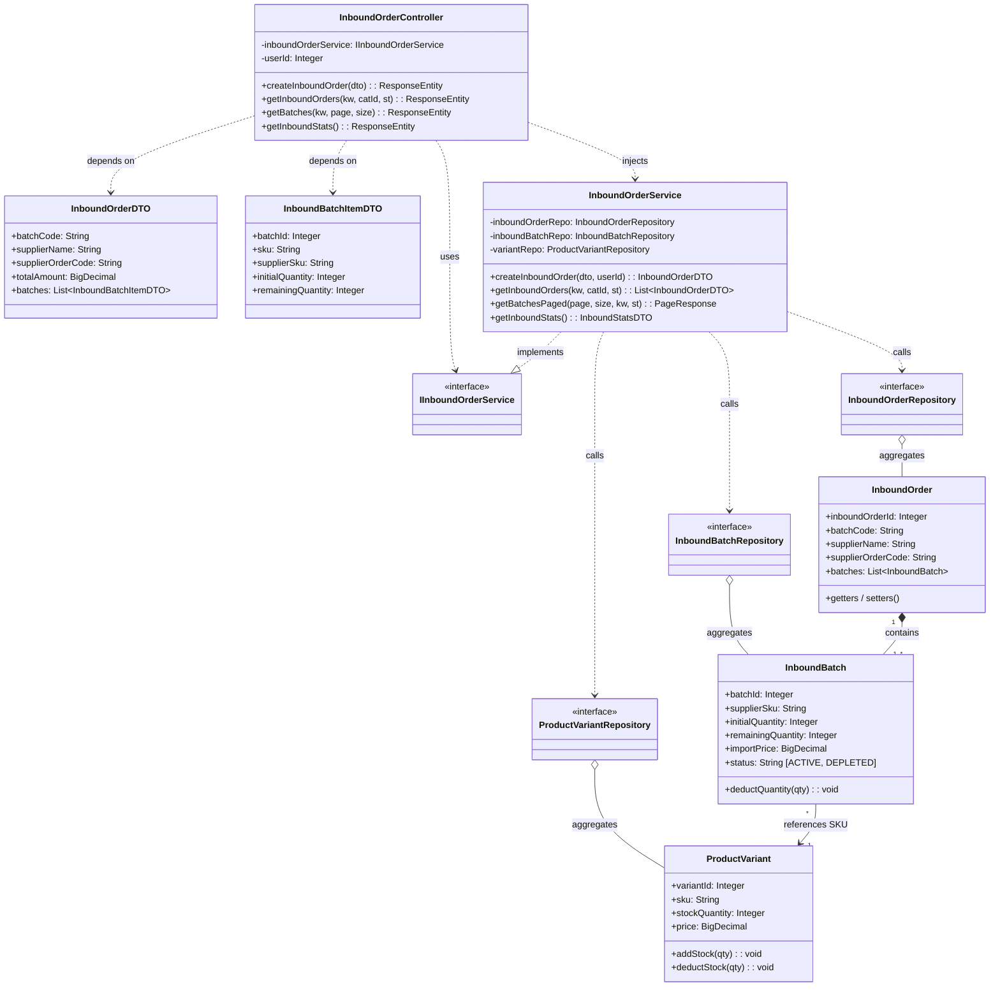
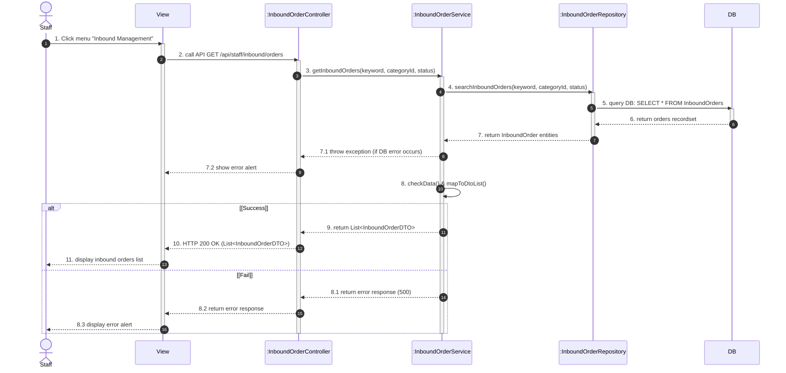
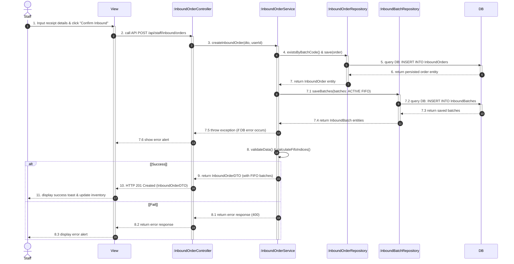

# SYSTEM DESIGN SPECIFICATION: INBOUND & FIFO BATCH MANAGEMENT
## Class Diagram & Sequence Diagrams (English Standard)
### FashionStore E-Commerce System

The Draw.io diagram file has been generated and validated with zero XML errors at both paths:
* **Root Directory File**: [`inbound_fifo_class_sequence_diagrams.drawio`](file:///c:/Users/THUY%20TOAN/OneDrive/Desktop/SWP2/FashionStoreNew/inbound_fifo_class_sequence_diagrams.drawio)
* **Docs Directory File**: [`docs/inbound_fifo_class_sequence_diagrams.drawio`](file:///c:/Users/THUY%20TOAN/OneDrive/Desktop/SWP2/FashionStoreNew/docs/inbound_fifo_class_sequence_diagrams.drawio)

The file contains **3 Dedicated Tabs** in 100% professional English:
1. **Tab 1: `Class Diagram - Inbound & FIFO`** (UML Class architecture with DTOs, Controller, Service, Repositories, and Entities).
2. **Tab 2: `Sequence - View Inbound Orders`** (Query / Read flow following the exact standard numbering convention 1 to 11 with `[Success]` and `[Fail]`).
3. **Tab 3: `Sequence - Create Inbound Order`** (Transactional creation flow with FIFO batch allocation and real-time inventory updates).

---

# 1. UML CLASS DIAGRAM (TAB 1)

### Structural Layout & Spacing:
* **Balanced Column Spacing (240px - 270px gap)**: Horizontally balanced lifelines (`Staff`, `View`, `Controller`, `Service`, `Repositories`, `DB`). Every message label fits comfortably with 15px - 25px breathing margin, preventing any text overflow while avoiding unnecessary emptiness or horizontal scrolling.
* **Pixel-Exact Arrow Connection**: All message arrows connect precisely to the outer edges of activation bars (`xC - 5` on the left, `xC + 5` on the right) with zero penetration.
* **Top (DTOs)**: `InboundOrderDTO` & `InboundBatchItemDTO`
* **Left (Interface)**: `«interface» IInboundOrderService`
* **Center (Core)**: `InboundOrderController` $\rightarrow$ `InboundOrderService`
* **Bottom Row (Repositories & Entities)**:
  * `InboundOrderRepository` $\diamond$---- `InboundOrder` (Receipt entity)
  * `InboundBatchRepository` $\diamond$---- `InboundBatch` (FIFO batch entity)
  * `ProductVariantRepository` $\diamond$---- `ProductVariant` (SKU stock entity)
* **Entity Relationships**:
  * `InboundOrder` (1) $\blacklozenge$--------- (1..*) `InboundBatch` (Composition)
  * `InboundBatch` (*) ----------- (1) `ProductVariant` (Association)

---

# 2. SEQUENCE DIAGRAM: VIEW INBOUND ORDERS (TAB 2)

---

# 3. SEQUENCE DIAGRAM: CREATE INBOUND ORDER & FIFO BATCHES (TAB 3)

