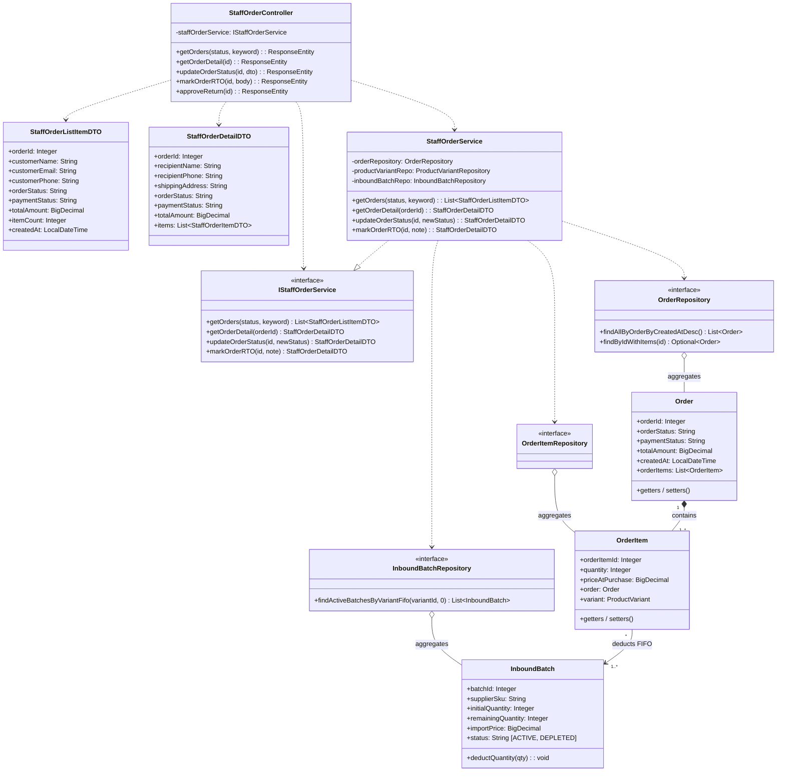
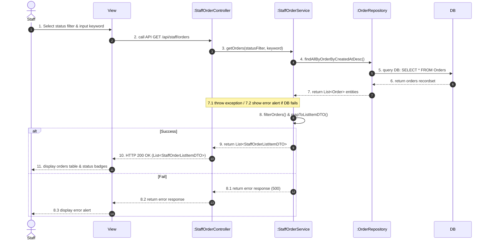
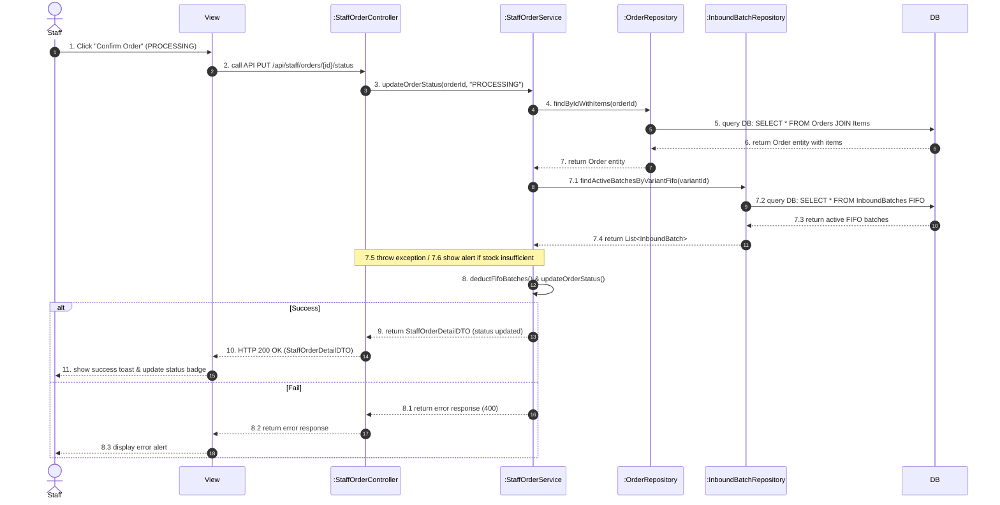

# SYSTEM DESIGN SPECIFICATION: ORDER PROCESSING & STATUS WORKFLOW
## Class Diagram & Sequence Diagrams (English Standard)
### FashionStore E-Commerce System

The Draw.io diagram file has been generated and validated with zero XML errors at both paths:
* **Root Directory File**: [`order_processing_class_sequence_diagrams.drawio`](file:///c:/Users/THUY%20TOAN/OneDrive/Desktop/SWP2/FashionStoreNew/order_processing_class_sequence_diagrams.drawio)
* **Docs Directory File**: [`docs/order_processing_class_sequence_diagrams.drawio`](file:///c:/Users/THUY%20TOAN/OneDrive/Desktop/SWP2/FashionStoreNew/docs/order_processing_class_sequence_diagrams.drawio)

The file contains **3 Dedicated Tabs** in 100% professional English:
1. **Tab 1: `Class Diagram - Order Processing`** (UML Class architecture with DTOs, Controller, Service, Repositories, and Entities).
2. **Tab 2: `Sequence - View & Filter Orders`** (Query / Read flow following the exact standard numbering convention 1 to 11 with `[Success]` and `[Fail]`).
3. **Tab 3: `Sequence - Process Order (FIFO)`** (Transactional status transition flow from `PENDING` to `PROCESSING` with FIFO batch allocation and inventory deduction).

---

# 1. UML CLASS DIAGRAM (TAB 1)

### Structural Layout & Spacing:
* **Balanced Column Spacing (240px - 270px gap)**: Horizontally balanced lifelines (`Staff`, `View`, `Controller`, `Service`, `Repositories`, `DB`). Every message label fits comfortably with 15px - 25px breathing margin, preventing any text overflow while avoiding unnecessary emptiness or horizontal scrolling.
* **Pixel-Exact Arrow Connection**: All message arrows connect precisely to the outer edges of activation bars (`xC - 5` on the left, `xC + 5` on the right) with zero penetration.
* **Top (DTOs)**: `StaffOrderListItemDTO` & `StaffOrderDetailDTO`
* **Left (Interface)**: `«interface» IStaffOrderService`
* **Center (Core)**: `StaffOrderController` $\rightarrow$ `StaffOrderService`
* **Bottom Row (Repositories & Entities)**:
  * `OrderRepository` $\diamond$---- `Order` (Sales Order entity)
  * `OrderItemRepository` $\diamond$---- `OrderItem` (Order line item entity)
  * `InboundBatchRepository` $\diamond$---- `InboundBatch` (FIFO batch deduction entity)
* **Entity Relationships**:
  * `Order` (1) $\blacklozenge$--------- (1..*) `OrderItem` (Composition)
  * `OrderItem` (*) ----------- (1..*) `InboundBatch` (Association / FIFO allocation)

---

# 2. SEQUENCE DIAGRAM 1: VIEW & FILTER ORDERS (TAB 2)

### Flow Summary:
Staff views the order management screen and filters orders by status (`PENDING`, `PROCESSING`, `SHIPPED`, `DELIVERED`, `CANCELLED`) or customer keyword.

---

# 3. SEQUENCE DIAGRAM 2: PROCESS ORDER & FIFO ALLOCATION (TAB 3)

### Flow Summary:
Staff processes an order from `PENDING` to `PROCESSING`. The system verifies real-time stock across active FIFO batches, deducts quantities from oldest batches first, marks exhausted batches as `DEPLETED`, updates product variant inventory, and changes order status atomically under `@Transactional`.

